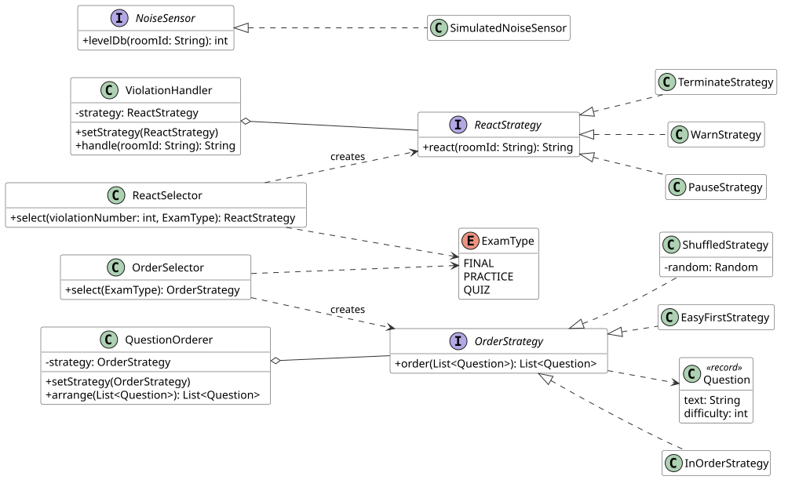

# Exam Proctoring: Strategy Pattern

The program checks online exams. Two jobs can be done in different ways, so each one has its own strategies:

- **Reaction** to a violation: warn, pause, terminate.
- **Question order**: as in the bank, shuffled, easy first.

## UML


## Classes

| Class | What it does |
|---|---|
| `ReactStrategy` | Interface that reacts to a violation in a room. |
| `WarnStrategy` | Writes a warning to the log. |
| `PauseStrategy` | Pauses the exam. |
| `TerminateStrategy` | Ends the exam and notifies the teacher. |
| `ViolationHandler` | Context that calls the react strategy it holds. |
| `ReactSelector` | Picks a react strategy from the violation number plus the exam type (final is one step stricter). |
| `OrderStrategy` | Interface that orders a list of questions. |
| `InOrderStrategy` | Keeps the order of the question bank. |
| `ShuffledStrategy` | Shuffles the questions at random. |
| `EasyFirstStrategy` | Sorts from easy to hard. |
| `QuestionOrderer` | Context that calls the order strategy it holds. |
| `OrderSelector` | Picks an order strategy from the exam type: final shuffled, practice in order, quiz easy first. |
| `ExamType` | Lists the exam types. |
| `Question` | Data of one question. |
| `NoiseSensor` | Interface that hides the source of the noise level. |
| `SimulatedNoiseSensor` | Gives a fixed fake noise level. |
| `Main` | Demo of both selectors. |

## Why Strategy

- It is not **State**: nothing changes the algorithm from inside. The caller or the selector picks it from outside.
- It is not **Template Method**: there is no base class with fixed steps. Each algorithm is a separate object, and we can swap it while the program runs with `setStrategy()`.
- Each strategy is a full algorithm with the same input and output. To add a new one, write a new class. Old code stays the same.

## Run

```
./gradlew test
./gradlew run
```
